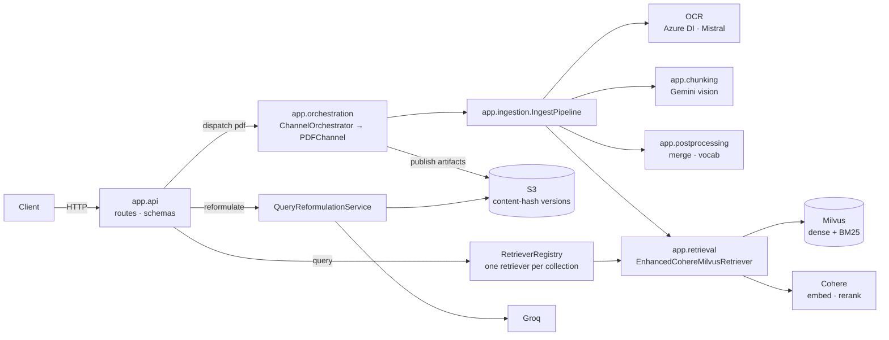

# Vision RAG Service

One deployable FastAPI service that turns PDFs into a searchable Milvus collection and answers hybrid
retrieval queries over it.

```
PDF ──► OCR (Azure or Mistral) ──► Gemini vision chunking ──► cross-page merge ──► Cohere embeddings + Milvus BM25
                                                                                     │
query ──► [dense ‖ BM25] ──► fusion (RRF / weighted / DBSF) ──► Cohere rerank ──► top-k ◄┘
```

| | |
|---|---|
| **Ingest** | `POST /v1/documents` — multipart PDF, processed synchronously, one at a time |
| **Query** | `POST /v1/retrieval/query` — hybrid dense + BM25 search with optional rerank |
| **Reformulate** | `POST /v1/retrieval/query-reformulation` — rewrite a query in the collection's vocabulary |
| **Collections** | `GET /v1/collections`, `DELETE /v1/collections/{name}` — list / drop collections for clients without a Milvus connection |
| **Health** | `GET /v1/health`, `GET /v1/ready` |

Full reference: [docs/ARCHITECTURE.md](docs/ARCHITECTURE.md) · [docs/API.md](docs/API.md) ·
[docs/CONFIGURATION.md](docs/CONFIGURATION.md) · [docs/ARTIFACTS.md](docs/ARTIFACTS.md) ·
[docs/DEPLOYMENT.md](docs/DEPLOYMENT.md) · [docs/JAPANESE_RETRIEVAL.md](docs/JAPANESE_RETRIEVAL.md)

---

## Architecture at a glance



Design rules that hold everywhere:

- **One config per concern.** `ChunkerConfig` (providers, Milvus, pipeline) and `ServerSettings` (HTTP layer) are
  read once from the environment; `RetrievalConfig` is a frozen dataclass with per-request `with_overrides()`.
- **One shape per artifact.** The Gemini response schema, the chunk store, the merger and the retriever all
  use the same field names — nothing guesses keys (see [docs/ARTIFACTS.md](docs/ARTIFACTS.md)).
- **Explicit failure policy.** Primary paths raise; secondary paths degrade and log (BM25 arm, reranker,
  reformulation, S3 retention). Every module docstring states which is which.
- **Resources are owned.** Retrievers live in a registry for the process lifetime; the pipeline's upload
  retriever is a context manager; production workspaces are temp dirs removed in every outcome.

## Quick start

```bash
python -m venv .venv && source .venv/bin/activate
pip install -r requirements-dev.txt
cp .env.example .env          # fill in GOOGLE_API_KEY, COHERE_API_KEY, MILVUS_HOST and the
                              # keys for your OCR engine (config.yaml → ocr.technique):
                              #   azure   → AZURE_OCR_ENDPOINT + AZURE_OCR_KEY
                              #   mistral → MISTRAL_API_KEY
uvicorn app.main:app --reload
```

Milvus **2.6+** must be reachable — BM25 runs server-side, and Japanese collections use its Lindera analyzer.
Each collection holds one language (Japanese or English, detected per PDF) with its own analyzer and
Cohere models — see [docs/JAPANESE_RETRIEVAL.md](docs/JAPANESE_RETRIEVAL.md).
The quickest way to get both the service and Milvus running is Docker Compose:

```bash
cp .env.example .env          # fill in the provider keys
docker compose up -d --build  # service on :8001, standalone Milvus on :19530
```

To run only Milvus (e.g. alongside `uvicorn --reload` on the host): `docker compose up -d milvus`.

```bash
# ingest
curl -F file=@manual.pdf -F collection_name=manuals localhost:8000/v1/documents

# query
curl -X POST localhost:8000/v1/retrieval/query -H 'content-type: application/json' \
     -d '{"collection_name":"manuals","query":"cold start procedure","top_k":5}'
```

## Repository layout

```
app/
├── main.py                 application factory + lifespan (startup wiring, shutdown cleanup)
├── api/                    routes, request/response schemas, error shape, dependency accessors
├── orchestration/          source-type dispatch; PDFChannel owns workspace + S3 publication
├── ingestion/              OCR, markdown → pages, IngestPipeline (8 stages)
├── chunking/               Gemini vision chunker, response schema, chunk store, token accounting, prompts/
├── postprocessing/         cross-page merger, vocabulary index
├── classification/         main/sub category per chunk: category memory, Gemini classifier, prompts/
├── groundtruth/            optional Q&A evaluation-set generator
├── retrieval/              retriever, language profiles + Milvus schema, fusion, rerank, embeddings, reformulation, registry
├── datasets/               ground-truth dataset contract, validation, publication, Langfuse mirror
├── storage/                S3 artifact store (content-hash versions, publish, retention), dataset store, S3 client builder
├── config/                 ChunkerConfig, ServerSettings, AWS credentials / client options
├── logging/                structured logging (console in dev, JSON elsewhere)
├── observability/          module registry, execution context, Langfuse tracing facade
├── concurrency.py          single-flight admission gate for ingestion
└── utils/                  JSON repair, naming, PDF rendering
tests/                      offline unit tests (fakes for every provider) — kept locally, gitignored
docs/                       current documentation; docs/archive/ holds superseded design notes
```

## Development

```bash
pytest -q            # 71 tests, no network
ruff check app tests
```

## Documentation

| Document | Contents |
|---|---|
| [docs/ARCHITECTURE.md](docs/ARCHITECTURE.md) | Components, ingestion & retrieval flows, fusion, concurrency, failure policy |
| [docs/API.md](docs/API.md) | Endpoints, payloads, error codes, examples |
| [docs/CONFIGURATION.md](docs/CONFIGURATION.md) | Every environment variable and config field |
| [docs/ARTIFACTS.md](docs/ARTIFACTS.md) | On-disk / S3 artifact contracts and the Milvus schema |
| [docs/CLASSIFICATION.md](docs/CLASSIFICATION.md) | Stage 5 chunk classification: category memory, rules, Milvus filter fields |
| [docs/JAPANESE_RETRIEVAL.md](docs/JAPANESE_RETRIEVAL.md) | Language profiles, Japanese benchmark, Milvus 2.6 upgrade and re-ingest runbook |
| [docs/DEPLOYMENT.md](docs/DEPLOYMENT.md) | Container, sizing, readiness, logs, S3 permissions |
| [docs/OBSERVABILITY.md](docs/OBSERVABILITY.md) | Langfuse tracing: module registry, execution headers, trace shapes, how an evaluation pipeline queries them |
| [docs/DATASETS.md](docs/DATASETS.md) | Ground-truth datasets: S3 layout, immutable versions, `retrieval_v1` CSV contract, API, Langfuse mirror |
| [docs/archive/](docs/archive/) | Historical migration plans and reviews (superseded) |


##  Fix

```bash
--> S3ArtifactStore
--> ChunkStore
--> merger.py
--> 
```