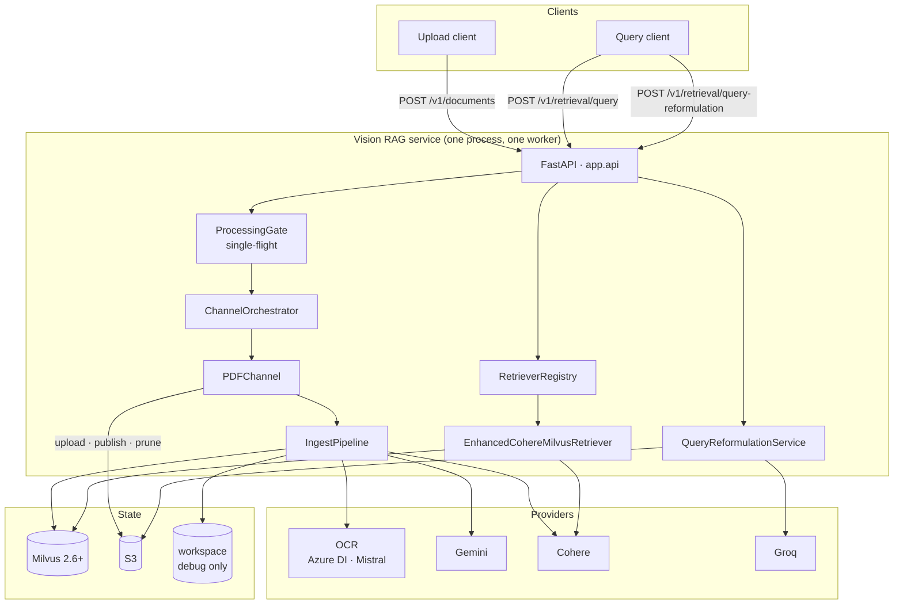
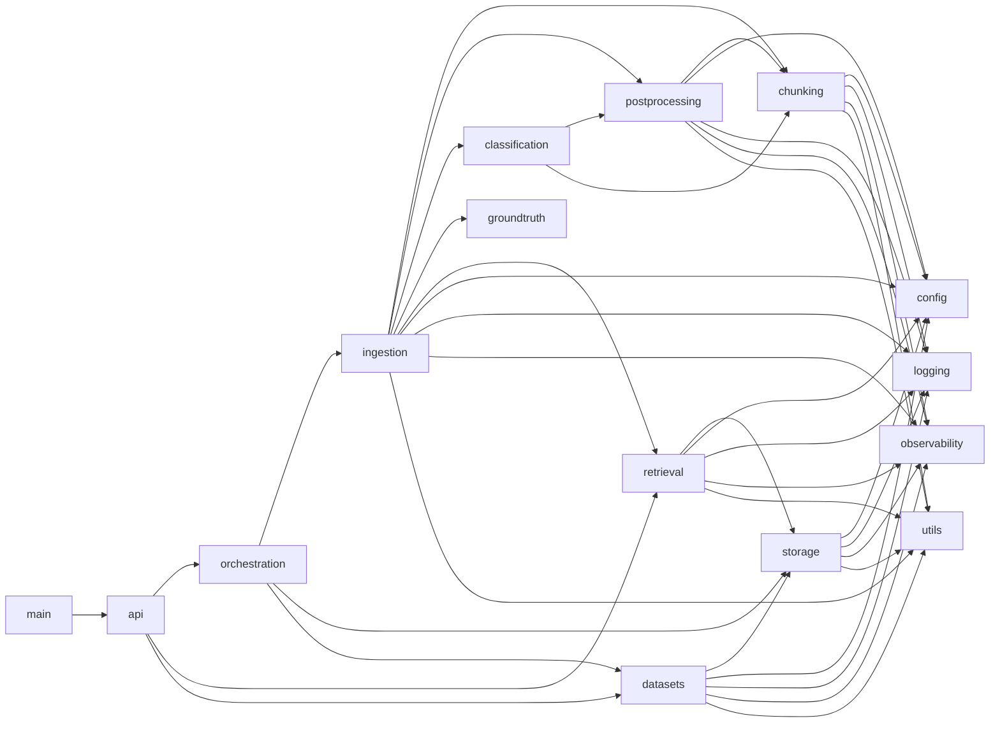
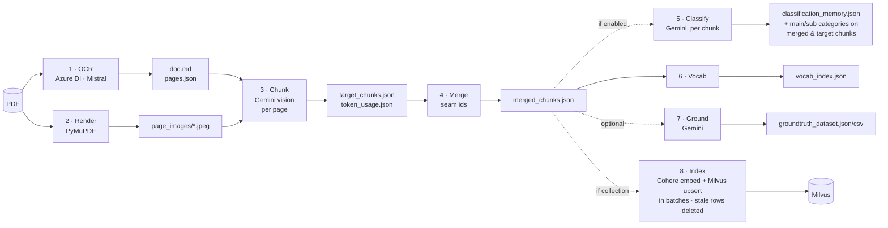
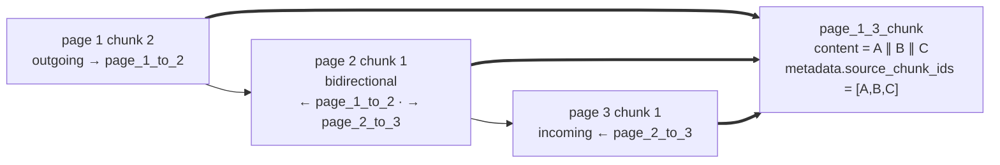
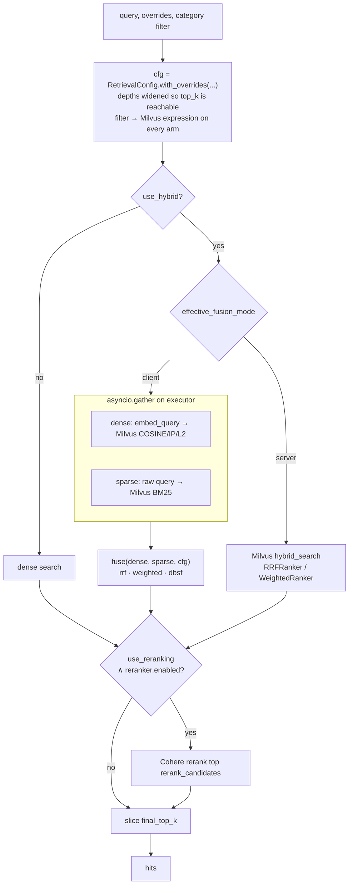

# Architecture

## 1. System context



Process-scoped objects are created once in `app.main.create_app`'s lifespan and reached by routes only
through `app.api.dependencies`.

## 2. Module map and dependency direction



Dependencies only point downward; `config`, `logging`, `utils` depend on nothing in `app`, and `observability`
only on `logging`.

| Package | Responsibility | Key types |
|---|---|---|
| `app.api` | HTTP contract, validation, error shape, upload streaming | `RetrievalQueryRequest`, `http_error`, `stage_upload` |
| `app.orchestration` | source-type dispatch, document workspace, S3 publication, durable ingestion jobs, re-indexing / auto-grounding a published S3 document | `ChannelOrchestrator`, `PDFChannel`, `IngestionJobManager`, `JobStore`, `S3DocumentImporter`, `S3DocumentGrounder` |
| `app.ingestion` | OCR (retried, windowed), page parsing, eight-stage pipeline | `IngestPipeline`, `IngestResult`, `IncompleteStageError` |
| `app.chunking` | Gemini vision chunking + persistence | `IntelligentPDFChunker`, `ChunkingResponse`, `ChunkStore` |
| `app.postprocessing` | cross-page merge, vocabulary index | `merge_chunks`, `build_vocab_index` |
| `app.classification` | main/sub category per merged chunk, general + created category memory | `ClassificationStage`, `CategoryMemory`, `ChunkClassifier` |
| `app.groundtruth` | optional evaluation Q&A | `AutoGrounder` |
| `app.retrieval` | Milvus hybrid search, fusion, rerank, reformulation | `EnhancedCohereMilvusRetriever`, `RetrievalConfig`, `fuse` |
| `app.datasets` | ground-truth dataset contract (`retrieval_v1`), streaming validation, publication, Langfuse mirror — [DATASETS.md](DATASETS.md) | `DatasetService`, `validate_csv`, `SCHEMAS` |
| `app.storage` | content-hash-versioned S3 artifacts; immutable, content-addressed dataset versions; the one S3 client builder | `S3ArtifactStore`, `S3DatasetStore`, `build_s3_client` |
| `app.config` | environment-backed settings | `ChunkerConfig`, `ServerSettings`, `AwsCredentials`, `S3ClientOptions` |
| `app.logging` | console/JSON logging with request context | `configure_logging`, `get_logger`, `in_context` |
| `app.observability` | module registry, execution context, Langfuse tracing facade — [OBSERVABILITY.md](OBSERVABILITY.md) | `ModuleName`, `SpanName`, `ExecutionContext`, `get_telemetry` |
| `app.utils` | crash-safe writes, naming, PDF rendering, JSON repair, Gemini client | `atomic_write_json`, `move_file`, `gemini_client` |

## 3. Ingestion flow

```mermaid
sequenceDiagram
    autonumber
    participant C as Client
    participant R as documents route
    participant G as ProcessingGate
    participant P as PDFChannel
    participant I as IngestPipeline
    participant S as S3ArtifactStore

    C->>R: POST /v1/documents (file, collection_name?, autogrounding?, s3_bucket?)
    R->>R: document_id = sanitize(file stem) · stream upload to _uploads/ (SHA-256, size cap)
    R->>G: try_acquire()
    alt busy
        G-->>R: false
        R-->>C: 429 SERVER_BUSY (Retry-After: 5)
    end
    R->>P: dispatch("pdf") on worker thread
    P->>P: validate (.pdf, %PDF-, size, PyMuPDF opens, not encrypted, ≤ MAX_PDF_PAGES)
    P->>P: admit: workspace (reset if other content) · move PDF in · hash marker
    P->>P: resolve S3 store
    P->>I: run(pdf, collection_name, autogrounding, language, classification)
    Note over I: stage 1 ocr → stage 2 render → stage 3 chunk (per page, resumable)<br/>stage 4 merge → [stage 5 classify] → stage 6 vocab → [stage 7 ground] → [stage 8 index]
    I-->>P: IngestResult
    opt S3_UPLOAD_ENABLED
        P->>S: upload_artifacts(hash) → publish_version → cleanup_old_versions
    end
    P->>P: production: rmtree(workspace) on success; kept on failure for a resume
    R->>G: release()
    R-->>C: 200 {document_id, page_count, chunk_count, collection_name, artifacts?}
```

### Pipeline stages



Stages 1–3 are skipped when their outputs exist and are newer than the PDF, so a kept workspace (debug, or a
failed production run) costs only what changed. Every artifact a later run may reuse is written atomically
(`app/utils/fs.py`), so a crash never leaves a truncated file that looks finished. `pages.json` always holds every
PDF page: a page the OCR engine skipped gets empty text and is chunked from its image. Stage 1 runs long PDFs as page windows (`app/ingestion/ocr/windows.py`,
resumable per window) while stage 2 renders on a background thread; stage 3 chunks `chunking_concurrency` pages at
once and resumes per page via `ChunkStore.completed_pages()` (the store is kept in document order whatever order
pages finish in); stage 5 classifies `classification_batch_size` chunks per call and re-applies every stored
assignment whose chunk content is unchanged (see [CLASSIFICATION.md](CLASSIFICATION.md)); stage 7 grounds pages in
parallel. Each stage reports `(stage, done, total)` to the caller — the job API's progress.

**Large documents.** `POST /v1/ingestion-jobs` (`app/orchestration/jobs.py`) runs the same channel on a background
thread behind the same gate and is polled. The job is recorded under `<workspace root>/_jobs/`; a run that fails with a
retryable error is run again (`INGEST_JOB_MAX_ATTEMPTS`), each run resuming from the workspace
`<workspace root>/<document_id>/` (content-hash marker; the PDF is moved in once so artifacts stay fresh); a restart
continues the interrupted job. Stage 3 attempts every page before failing and names the pages that failed every
retry, so a rerun chunks only those. Every Gemini call has `gemini_request_timeout`, every OCR call
`ocr_request_timeout` and retries; the chunker's system-prompt cache is extended between pages and replaced once if
it expires mid-document. Details: [INGESTION_RELIABILITY.md](INGESTION_RELIABILITY.md).

### Chunking contract

The Gemini call is schema-constrained to `ChunkingResponse`; its field names are the field names in the
system prompt and in every artifact. Each chunk carries a `continuation_type` and seam ids
(`page_{N}_to_{N+1}`) that the merger uses to fuse halves of an idea split by a page break:



When the model omits a seam id, the immediately following `outgoing` chunk is absorbed instead (capped at 9).
Chunk ids are assigned by `ChunkingResponse.to_records` (`page_{N}_chunk_{M}`, from the page and emission order) —
never trusted from the model — and merged ids are made unique, because both key Milvus rows and classifications.

## 4. Retrieval flow



### Fusion strategies

| Strategy | Client-side | Server-side (Milvus native) | Character |
|---|---|---|---|
| `rrf` (default) | `Σ w / (k + rank)` | `RRFRanker(k)` | rank-based; immune to score-scale differences |
| `weighted` | min-max normalise → `α·dense + (1-α)·sparse` | `WeightedRanker(α, 1-α)` | keeps magnitude; a dominant dense hit stays dominant |
| `dbsf` | z-score (±3σ) normalise → α blend | — (falls back to client) | outlier-tolerant |

`alpha` is the dense share in `[0, 1]` for every strategy. Client mode returns per-arm diagnostics on
each hit (`dense_rank`, `dense_score`, `sparse_rank`, `sparse_score`); server mode is one round-trip.

### Hit shape

```json
{
  "chunk_id": "page_3_chunk_1", "text": "…", "page": 3,
  "metadata": {"chunk_id": "…", "page": 3, "image_paths": ["page_3_img_1.png"], "reference_path": "…", "doc_length": 812, "word_count": 140,
               "main_category": "maintenance", "sub_categories": ["safety"]},
  "score": 0.0312, "final_score": 0.91, "retrieval_source": "reranked",
  "dense_rank": 1, "dense_score": 0.83, "sparse_rank": 4, "sparse_score": 11.2, "rerank_score": 0.91
}
```

`score` is the fused score; `final_score` is what ordered the result (rerank score when reranked).

## 5. Milvus collection

| Field | Type | Source |
|---|---|---|
| `chunk_id` | VARCHAR, primary key | `{document_id}:{chunk_id}` (or a blake2b content hash when absent) |
| `document_id` | VARCHAR | sanitised PDF stem the chunk came from |
| `page` | INT64 | first source page, `-1` when unknown |
| `text` | VARCHAR (analyzer enabled) | document `page_content`, ≤ 60 000 bytes; analyzer = the collection language's (English `standard` / Japanese Lindera IPADIC) |
| `dense` | FLOAT_VECTOR | Cohere embeddings of the collection's embedding model; index type/metric from `ChunkerConfig` |
| `sparse` | SPARSE_FLOAT_VECTOR | BM25 over `text`, computed by a Milvus BM25 function |
| `main_category` | VARCHAR(64), nullable, INVERTED index | stage 5 main category; NULL when unclassified (schema v2) |
| `sub_categories` | ARRAY<VARCHAR(64)>, nullable, INVERTED index | stage 5 sub categories (schema v2) |
| `$meta` (dynamic) | JSON | every other metadata key: `image_paths`, `reference_path`, `language`, `doc_length`, `word_count` (and the category keys on schema-v1 collections) |

The schema is declared in `app/retrieval/milvus_schema.py`. The collection property `maryuma.manifest`
records `{language, embedding_model, dense_dim}`; the retriever binds to it and searches with that analyzer
and model (see [JAPANESE_RETRIEVAL.md](JAPANESE_RETRIEVAL.md)). It also reads the dense index's actual
metric, so a collection created under a different setting still searches correctly. The first write into a
collection creates it for the document's language; later writes are `upsert`s keyed by `chunk_id`. Because the key is scoped by
`document_id`, re-ingesting a document replaces exactly its own chunks and other documents in the collection
are untouched.

## 6. Concurrency & lifecycle

```mermaid
stateDiagram-v2
    [*] --> Starting: uvicorn imports app.main
    Starting --> Ready: lifespan builds settings · ChunkerConfig · orchestrator · gate · job manager · registry · reformulation
    Starting --> Ingesting: an interrupted job is recorded and auto-resume is on
    Ready --> Ingesting: gate.try_acquire() succeeds
    Ingesting --> Ready: gate.release() (always, in finally; before a job's final status is published)
    Ready --> Ready: retrieval queries (no gate; executor per collection)
    Ready --> Stopping: shutdown signal
    Stopping --> [*]: job retry waits stopped · registry.close_all() → executors joined, Milvus clients closed
```



- **Ingestion** runs on a Starlette worker thread (`/v1/documents`) or a job thread (`/v1/ingestion-jobs`) behind
  `ProcessingGate`: at most one document per process. The Dockerfile pins `--workers 1` because the gate is
  in-process. A job thread holds the gate across its retry waits.
- **Uploads** are streamed to `<workspace root>/_uploads/` and moved into the document's workspace on admission;
  no request or job holds a PDF in memory.
- **Retrieval** never blocks the event loop: every Milvus/Cohere call runs on the retriever's own
  `ThreadPoolExecutor`; both arms run concurrently via `asyncio.gather`.
- **Retrievers** are process-scoped (`RetrieverRegistry`), safe for concurrent `retrieve_async` calls,
  and closed once at shutdown. The pipeline's upload retriever is a context manager and is released per
  ingestion.
- **Workspaces**: `<workspace root>/<document_id>/` holds the PDF, its hash marker and the artifact folder
  `<document_id>/`. Debug mode (`DEBUG_WORKSPACE`) keeps it; production (`INGEST_WORKSPACE_DIR`) removes it on
  success, keeps it on failure for a resume, and prunes it after `INGEST_WORKSPACE_RETENTION_HOURS` idle. A different
  PDF under the same id starts clean in both modes.
- **Job records**: `<workspace root>/_jobs/<job_id>.json`, rewritten on every status change (progress at most every
  5 s); loaded at startup, pruned `INGEST_JOB_RETENTION_HOURS` after a job finishes.
- **Inside one ingestion**: OCR windows (`ocr_concurrency`), page chunking and grounding (`chunking_concurrency`)
  run on thread pools (each task bound to the caller's log context with `in_context`); `ChunkStore`,
  `TokenUsageMonitor` and the chunker's cache state are lock-guarded.
  Classification stays sequential across batches (later chunks must see created categories).

## 7. Failure policy

| Path | Policy |
|---|---|
| OCR, render, chunk, merge, vocab | propagate → HTTP 500 `PROCESSING_FAILED` (job: run again up to `INGEST_JOB_MAX_ATTEMPTS`, then `error.retryable: true`); nothing is published; the workspace is kept so a rerun resumes |
| OCR call | retried (`ocr_max_retries`, back-off from `ocr_retry_delay`) unless misconfigured, empty, or a 4xx other than 408/429 |
| A chunk page failing every retry | the other pages go on; the stage then raises `IncompleteStageError` naming the failed pages (a rerun chunks only those) |
| An error every page would hit (Gemini 401/403/404, invalid key) | stage 3 stops at once; pages already running finish and are stored |
| Service restart during a job | the job record stays `running`; startup continues it from its workspace (`INGEST_JOB_AUTO_RESUME`) |
| Classification batch call | retried; then every chunk of the batch is classified alone; a missing or rule-breaking answer is classified alone |
| Classification of one chunk | retried (`classification_max_retries`, invalid answers included); then recorded in `failures`, indexed with `main_category: null`, retried on the next run |
| Chunking / grounding / classification Gemini calls | retried with exponential back-off (`chunking_max_retries`, `autogrounding_max_retries`, `classification_max_retries`) |
| Auto-grounding page failure | recorded as an empty page with `error`; run completes; the page is grounded again by the next run |
| Milvus upload, stale-row deletion | propagate (document is not "ingested" until indexed, and a stale row is a wrong answer) |
| S3 upload / publish | propagate; `manifest.json` written last so a partial upload is never published |
| S3 retention | best-effort, logged |
| Dense arm | propagate → HTTP 500 `RETRIEVAL_FAILED` |
| BM25 arm | degrade to dense-only, ERROR log |
| Reranker | degrade to fused order, WARNING log |
| Query reformulation | every step degrades to the original query |
| Input validation | 400 (`INVALID_DOCUMENT` — incl. oversized, unreadable, encrypted, too many pages — `INVALID_COLLECTION_NAME`, `INVALID_REQUEST`, `S3_BUCKET_REQUIRED`) or 422 (schema, incl. unusable category names) |

## 8. Logging

`configure_logging` installs one handler set on `vision_rag_api`. Development environments get
`LEVEL: [MODULE]: message | request_id=… channel=… stage=…`; all others get one JSON object per line
with the same fields. `request_id` / `document_id` are context variables set per request by
`RequestContextMiddleware` (and restored by each job thread from the job record), and thread-pool tasks, the
render thread, S3 uploads and the retriever's executor calls run in the submitter's context (`in_context`), so
every log line inside a pipeline run — page workers included — is attributable without threading identifiers
through signatures. Query text is logged at INFO only as a fingerprint.

## 9. Tracing

The same context variables carry the OpenTelemetry span, so Langfuse traces ([OBSERVABILITY.md](OBSERVABILITY.md))
follow the same propagation: one root trace per workflow run, named by `ModuleName` and tagged with the
request's `X-Execution-*` context, stage / arm child spans, one generation per chunked page. The facade
(`app/observability/telemetry.py`) is a no-op when `LANGFUSE_ENABLED=false` and never raises into the run.
