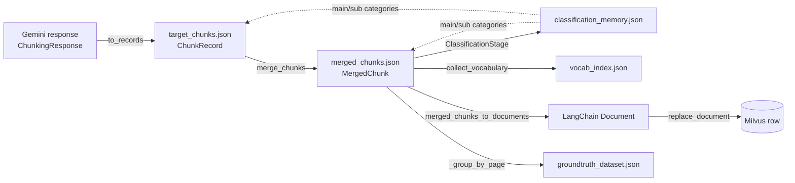
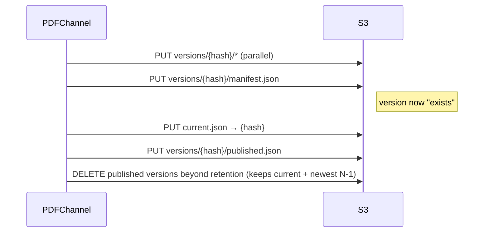

# Artifact contracts

Every ingestion writes the same set of files under `<workspace>/<document_id>/`. In debug mode they stay
on disk; in production they are uploaded to S3 (when enabled) and the local copy is removed. Every file is
written atomically (temp file + rename, `app/utils/fs.py`), so a crash never leaves a truncated artifact that a
resumed run would reuse.

```
<document_id>/
├── <document_id>.md          OCR markdown, one "# Page N" heading per page
├── ocr_windows/              (long PDFs, transient) per-window OCR, removed once <document_id>.md is stitched
├── pages.json                {"page_1": "...", …} — exactly one entry per PDF page ("" where OCR found none)
├── pdf_images/               figures the OCR stage extracted: page_{n}_img_{k}.{ext}
├── page_images/              rendered pages:            page_{n}.jpeg (200 dpi)
├── target_chunks.json        raw per-page chunks (ChunkStore)
├── target_chunks.empty_pages.json  pages chunked with zero chunks, e.g. [12, 500] (so a resume skips them)
├── token_usage.json          Gemini token accounting per page/attempt
├── merged_chunks.json        ← the published retrieval unit (+ categories when classified)
├── classification_memory.json (stage 5) general + created categories, per-chunk assignments
├── vocab_index.json          ← consumed by query reformulation
├── groundtruth_dataset.json  (optional) evaluation Q&A per page
└── groundtruth_dataset.csv   (optional) flat rows
```



## `target_chunks.json` — `ChunkRecord`

`{"chunk1": ChunkRecord, "chunk2": …}` in document order (page, then emission order). Written by
`app.chunking.store.ChunkStore`; the keys are exactly the Gemini response schema (`app/chunking/schema.py`) plus
three page-level fields. `chunk_id` is always `page_{page_no}_chunk_{M}` (M from 1 in emission order), assigned by
`ChunkingResponse.to_records` whatever the model wrote, so it is unique within the document. Chunking a page again
replaces that page's records.
When stage 5 ran, every record also carries the `main_category` / `sub_categories` of the merged chunk it
ended up in (a record fused into a cross-page chunk gets that chunk's categories).

```json
{
  "chunk_id": "page_3_chunk_1",
  "text": "verbatim current-page text, boilerplate and image markdown removed",
  "images": [{"path": "page_3_img_1.png", "association": "semantic"}],
  "chunk_description": "one sentence",
  "continuation_type": "incoming",
  "incoming_group_id": "page_2_to_3",
  "outgoing_group_id": null,
  "oversized": false,
  "index_concept_vocabulary": ["cooling air intake", "fan cover"],
  "page_no": 3,
  "ocr_corrections": [{"original": "recoilstarter", "corrected": "recoil starter", "confidence": 0.82, "context": "…"}],
  "content_continuation": {"from_previous_page": true, "to_next_page": false}
}
```

## `merged_chunks.json` — `MergedChunk`

`{"chunk1": MergedChunk, …}` in document order. This is the **external contract** (published to S3);
field names are stable. `chunk_id` is unique within the document: a standalone chunk keeps its raw id, a fused
chain is `page_{first}_{last}_chunk`, and a fused id already used gets `_2`, `_3`, … in document order.

```json
{
  "chunk_id": "page_1_3_chunk",
  "content": "text of page 1 half\ntext of page 2\ntext of page 3 half",
  "chunk_description": "desc 1 desc 2 desc 3",
  "concept_vocabulary": ["Fan", "PSI", "Valve"],
  "images": [{"path": "page_1_img_2.png", "association": "semantic"}],
  "main_category": "maintenance",
  "sub_categories": ["safety", "operation"],
  "metadata": {
    "source_chunk_ids": ["page_1_chunk_2", "page_2_chunk_1", "page_3_chunk_1"],
    "source_page_nos": ["1", "2", "3"],
    "merge_reason": "cross_page_continuation",
    "ocr_corrections": [ … ],
    "content_continuation": [ … ]
  }
}
```

- Standalone chunks keep their original `chunk_id`; fused chains are named `page_{first}_{last}_chunk`.
- `merge_reason` is present only on fused chunks; `ocr_corrections` / `content_continuation` only when non-empty.
- `concept_vocabulary` is case-insensitively deduplicated and capped at 7 terms.
- `main_category` / `sub_categories` are present only when stage 5 ran. `main_category` is a general or a
  created category, or `null` when the chunk could not be classified; `sub_categories` holds general
  categories only (never the main one), in taxonomy order.

## `classification_memory.json`

The state of stage 5 for this document ([CLASSIFICATION.md](CLASSIFICATION.md)). General and created
categories are kept apart; assignments are keyed by merged `chunk_id` and a fingerprint of the content the
classifier read, so an unchanged chunk is never classified twice.

```json
{
  "general_categories": {"operation": "Using the product…", "technical": "…", "safety": "…", "maintenance": "…", "troubleshooting": "…"},
  "created_categories": {"warranty": {"description": "Warranty coverage, claims and exclusions.", "first_chunk_id": "page_41_chunk_2"}},
  "chunks": {
    "page_1_3_chunk": {"fingerprint": "9c1e…", "main_category": "maintenance", "main_category_source": "general",
                       "sub_categories": ["safety"], "reasoning": "A cleaning procedure with a burn caution."},
    "page_41_chunk_2": {"fingerprint": "07ab…", "main_category": "warranty", "main_category_source": "created",
                        "sub_categories": [], "reasoning": "…"}
  },
  "failures": {"page_9_chunk_4": "RuntimeError: …"}
}
```

## `vocab_index.json`

A flat JSON array of unique terms across all chunks, in first-seen order:

```json
["cooling air intake", "fan cover", "PSI", "cold starting procedure"]
```

## `groundtruth_dataset.json`

```json
{
  "3": {
    "direct_questions":   [{"case_id": "operator_manual:3f1c9a0b2e7d", "question": "…", "answer": "…",
                            "answer_chunk_id": ["page_3_chunk_1"], "tag": "single"}],
    "indirect_questions": [ … ]
  }
}
```

A page whose generation failed every retry is stored with empty lists and an `"error"` string. `case_id` is
deterministic (`{document_id}:{sha256(page|type|question)[:12]}`); `answer_chunk_id` holds only ids that exist among
the page's chunks (invented ones are dropped, a question left without one is dropped).

`groundtruth_dataset.csv` is one row per question with the columns
`case_id, document_id, page, type, tag, answer_chunk_id, question, answer` (`answer_chunk_id` `;`-joined) — the
`retrieval_v1` dataset format of [DATASETS.md](DATASETS.md), so it can be published as a dataset version as is.

## Milvus row

Built by `app.retrieval.documents.merged_chunks_to_documents` then `EnhancedCohereMilvusRetriever.replace_document`:
the rows are upserted in batches of `index_batch_size`, then the document's rows from an earlier ingestion whose key
is not among them are deleted — a collection always holds exactly the latest version of each document.

| Column | From |
|---|---|
| `chunk_id` (PK) | `{document_id}:{MergedChunk.chunk_id}` — scoped so documents sharing a collection never collide |
| `document_id` | the sanitised PDF stem (identifies the document; never used as the collection name) |
| `text` | `INDEX_CONCEPT_VOCABULARY: …\n\nCHUNK_DESCRIPTION: …\n\nCHUNK: <content>` — vocabulary and description contribute to both the embedding and BM25 |
| `dense` | Cohere embedding of `text` |
| `sparse` | BM25 over `text`, computed by Milvus |
| `page` | first `source_page_nos` entry, `-1` when unknown |
| `image_paths` | list of image paths (dynamic field, stored as a JSON list) |
| `reference_path` | `reference_imgs/reference_page_{page}.png` (dynamic field) |
| `language` | the document's language, `ja` / `en` (dynamic field; the collection manifest is authoritative) |
| `main_category` | `MergedChunk.main_category`; NULL when unclassified or classification was off (typed column on schema-v2 collections, dynamic field on v1) |
| `sub_categories` | `MergedChunk.sub_categories` (typed ARRAY column on v2, dynamic field on v1) |
| `doc_length`, `word_count` | computed on write (dynamic field) |

## S3 layout (`S3_UPLOAD_ENABLED=true`)

```
{document_id}/
├── current.json                          {"document_id", "version", "published_at", "artifact_path"}
└── versions/{sha256 of the PDF bytes}/
    ├── <every non-hidden file from the workspace above>
    ├── manifest.json                     written LAST — its presence proves a complete upload; files[] carry path, size_bytes, sha256
    └── published.json                    {"published_at"} — retention bookkeeping
```

```
_collections/{collection_name}.json       which documents a Milvus collection holds — read by query reformulation
{"collection_name": "manuals_en", "language": "en", "updated_at": "…",
 "documents": {"operator_manual": {"registered_at": "…"}, "service_guide": {"registered_at": "…"}}}
```

The registry is written (best-effort; a failure is logged) after each successful ingest into a collection —
by the PDF channel when `S3_UPLOAD_ENABLED=true`, and by `POST /v1/documents/from-s3` — and deleted with
the collection (`DELETE /v1/collections/{name}`). Document ids never start with `_`, so `_collections/` never
clashes with a document folder. Query reformulation merges the current `vocab_index.json` of every listed
document.

```
_datasets/{module_name}/{dataset_name}/   ground-truth dataset versions (immutable, content-addressed) — see DATASETS.md
├── current.json
└── versions/{dataset_version}/{dataset.csv, manifest.json[, langfuse_sync.json]}
```



`POST /v1/documents/from-s3/autogrounding` later adds `groundtruth_dataset.{json,csv}` to an existing version
(`S3ArtifactStore.add_version_artifacts`): the files are uploaded first, then `manifest.json` is rewritten to list
them, with an `updated_at` field.

Re-ingesting byte-identical content refreshes its version — `manifest.json` lists every file with its `sha256`, and only files
whose hash changed (e.g. `merged_chunks.json` now classified) are uploaded, so S3 always matches what was indexed — followed by
a re-publish; changed content creates a
new version and the previous one is retained (default retention: 2).
