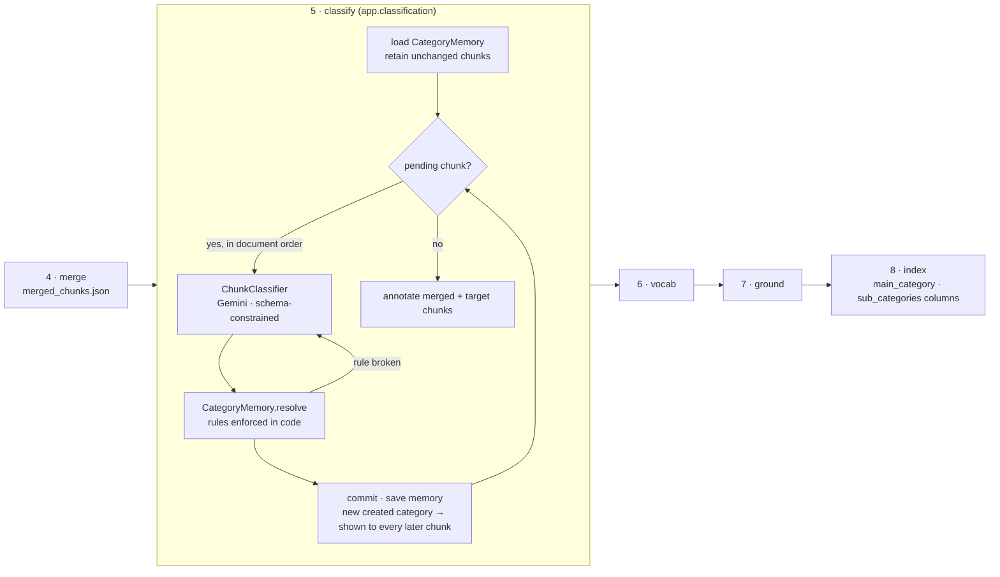

# Chunk classification (stage 5)

Every final retrieval unit — each merged chunk — is labelled with **one main category** and **zero or more sub
categories**. The labels are written onto the chunk artifacts and indexed as Milvus filter fields, so a query can
be narrowed to, for example, only `safety` content.



## The two kinds of category

| | General categories | Created categories |
|---|---|---|
| Source | `config.yaml` → `classification.categories` (default: `operation`, `technical`, `safety`, `maintenance`, `troubleshooting`) | invented by the model while classifying this document |
| Can be a main category | yes — the expected outcome for most chunks | yes — only when no general or earlier created category describes the chunk's main idea |
| Can be a sub category | yes | **never** |
| Stored | `classification_memory.json` → `general_categories` | `classification_memory.json` → `created_categories`, each with a definition and the chunk that introduced it |

The **memory** is what keeps created categories under control: chunks are classified in document order, in
batches of `classification_batch_size` (10) per Gemini call, and each request lists every category created so far
(with its definition), so the model reuses `warranty` on page 41 instead of inventing `warranty_terms` on page 42.
Within a batch the answers are committed in order, so a category created for one chunk counts as existing for the
next; a chunk the batch answer misses, or whose answer breaks a rule, is classified alone with the one-chunk prompt.

## Rules

The prompt states them (`app/classification/prompts/system_prompt.md`); `CategoryMemory.resolve` enforces them,
so a rule is never only a suggestion:

| Rule | Enforcement |
|---|---|
| exactly one `main_category` | schema-constrained output; an unusable name is rejected and **retried** |
| main is general → created → new, in that order | lookup in code; a new name is accepted only when `allow_new_categories` is on, else **retried** |
| `sub_categories` are general only | created / new / unknown names are **dropped** (logged at DEBUG) |
| the main category is not repeated as a sub category | dropped |
| names are lowercase ASCII `snake_case` | normalised (`"Trouble Shooting"` → `trouble_shooting`); names with no ASCII letters/digits are rejected |

Sub categories are returned in taxonomy order, de-duplicated.

## Resumability and cost

One Gemini call per merged chunk (text capped at 12 000 characters), ≈2.7 s each at the default
`classification_thinking_level: low` — about 2–3 minutes for a 50-chunk manual. The memory is saved after every chunk, and
each assignment is keyed by the chunk id **and a fingerprint** of what the classifier read (content, description,
vocabulary). Merge re-runs on every ingestion and rewrites `merged_chunks.json`, so stage 5 then:

- re-applies stored assignments for unchanged chunks — no model call;
- classifies only new or changed chunks;
- drops assignments of chunks that no longer exist, and created categories no remaining chunk uses;
- discards the whole memory when the *names* of the general categories change (definitions may change freely).

## Failure policy — secondary path

A chunk that fails every attempt (`classification_max_retries`, rule violations included) is recorded under
`failures`, written with `main_category: null`, `sub_categories: []`, and indexed without categories; the
ingestion completes. The next run retries it. A missing `GOOGLE_API_KEY` is a configuration error and fails the
run — but the chunker needs that key anyway.

## Milvus

| Collection | `main_category` | `sub_categories` |
|---|---|---|
| created from now on (manifest `schema_version: 2`) | `VARCHAR(64)`, nullable, INVERTED index | `ARRAY<VARCHAR(64)>` (≤ 32), nullable, INVERTED index |
| created before (schema v1) | dynamic field (`$meta`) | dynamic field (`$meta`) |
| legacy (no manifest) | — read-only, cannot be filtered | — |

`app/retrieval/filters.py` builds one expression that works on both v1 and v2 (verified against Milvus 2.6.24):

```text
main_categories = ["safety"]            →  main_category in ["safety"]
sub_categories  = ["maintenance"]       →  array_contains_any(sub_categories, ["maintenance"])
categories      = ["troubleshooting"]   →  (main_category in ["troubleshooting"] or array_contains_any(sub_categories, ["troubleshooting"]))
```

Lists given together are AND-ed. The expression is passed to the dense search, the BM25 search and both
`AnnSearchRequest`s of server-side hybrid search, so filtering happens before fusion and reranking. Request values
go through the same normaliser as stored names, which leaves only `[a-z0-9_]` — a filter value cannot alter the
expression. Categories are filter metadata only; they are not added to the embedded / BM25 text.

```bash
curl -X POST localhost:8000/v1/retrieval/query -H 'content-type: application/json' \
     -d '{"collection_name": "manuals", "query": "air filter", "categories": ["maintenance"], "top_k": 5}'
```

## Switching it

| Scope | How |
|---|---|
| Service default | `config.yaml` → `classification.enabled`, or `CLASSIFICATION_ENABLED` |
| One upload | `POST /v1/documents` form field `classification=true|false` |
| Taxonomy | `classification.categories` (name → definition; definitions are shown to the model and improve consistency) |
| Creation of new main categories | `classification.allow_new_categories` |

With the stage off, chunks carry no category keys and Milvus stores NULL — documents ingested with and without
classification can share a collection.

## Code map

| Module | Responsibility |
|---|---|
| `app/classification/schema.py` | `ClassificationResponse` (Gemini schema) and the persisted memory models |
| `app/classification/memory.py` | `CategoryMemory`: general vs created taxonomy, rules (`resolve`), state (`commit`, `retain`, `save`/`load`) |
| `app/classification/classifier.py` | `ChunkClassifier`: prompt rendering, Gemini call, retry loop |
| `app/classification/stage.py` | `ClassificationStage`: ordering, resumption, failure policy, artifact annotation |
| `app/retrieval/filters.py` | `CategoryFilter` → Milvus expression |
| `app/retrieval/milvus_schema.py` | typed category columns + INVERTED indexes (schema v2) |
