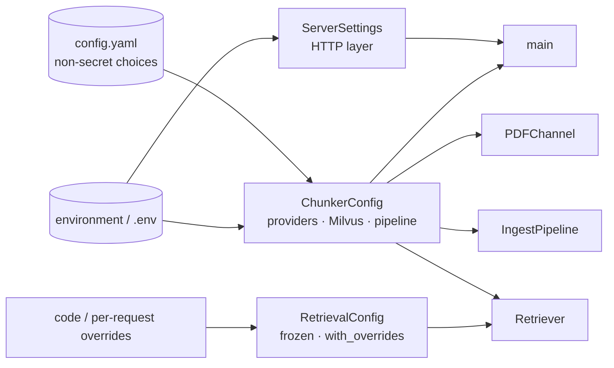

# Configuration

Three configuration objects, each owning one concern. All read the environment and an optional `.env`
(environment wins). Names are case-insensitive. Non-secret pipeline *choices* — the OCR engine and chunk
classification — additionally have a file layer, `config.yaml`, which sits below `.env` in priority.



Priority, highest first: **environment variable → `.env` → `config.yaml` → field default.**

## config.yaml (loaded by `app/config/settings.py`)

Read once at import from the repository root, or from `CONFIG_YAML_PATH` when that is set. The file is
optional — delete it and every key falls back to the same defaults shown below. It is baked into the
image and bind-mounted by `docker-compose.yml`, so the engine can be changed with a restart.

```yaml
ocr:
  technique: azure            # azure | mistral
  azure:
    model: prebuilt-layout    # or prebuilt-read (cheaper, plain text, no figures)
    extract_figures: true
    figure_dpi: 200
  mistral:
    model: mistral-ocr-latest

classification:
  enabled: true
  allow_new_categories: true
  categories:                 # name → definition shown to the model (a plain list of names also works)
    operation: …
    technical: …
    safety: …
    maintenance: …
    troubleshooting: …
```

| Key | Env override | Default | Meaning |
|---|---|---|---|
| `ocr.technique` | `OCR_TECHNIQUE` | `azure` | which engine runs stage 1; an unknown value fails at startup, not mid-upload |
| `ocr.azure.model` | `AZURE_OCR_MODEL` | `prebuilt-layout` | only `prebuilt-layout` returns markdown (tables, headings, figures) |
| `ocr.azure.extract_figures` | `AZURE_OCR_EXTRACT_FIGURES` | `true` | crop detected figures out of the PDF into `pdf_images/` |
| `ocr.azure.figure_dpi` | `AZURE_OCR_FIGURE_DPI` | `200` | resolution of those crops |
| `ocr.mistral.model` | `MISTRAL_OCR_MODEL` | `mistral-ocr-latest` | |
| `classification.enabled` | `CLASSIFICATION_ENABLED` | `true` | run stage 5; the `classification` form field overrides it per request |
| `classification.allow_new_categories` | `CLASSIFICATION_ALLOW_NEW_CATEGORIES` | `true` | let the model create a *main* category when no general or created one fits |
| `classification.categories` | `CLASSIFICATION_CATEGORIES` (JSON object or array) | the five above | the general taxonomy; 1–32 names, normalised to snake_case; changing the *names* discards stored assignments on the next run |

Both engines are interchangeable: same `run_ocr(...)` signature, same artifacts (`<doc>.md` with one
`# Page N` heading per page, `pdf_images/page_{n}_img_{k}.{ext}`, markdown referencing those files by
name), same fail-loud policy. Nothing downstream of stage 1 can tell which one ran.

## ServerSettings (`app/config/settings.py`)

| Variable | Default | Meaning |
|---|---|---|
| `APP_ENV` | `production` | `development` / `debug` / `local` → human-readable logs + rotating file; anything else → JSON logs |
| `ARTIFACT_MODE` | `production` | both modes use a per-document workspace `<root>/<document_id>/`; `debug` (root `DEBUG_WORKSPACE`) keeps it and returns artifact paths; `production` (root `INGEST_WORKSPACE_DIR`) removes it on success and keeps it on failure so a retry resumes |
| `DEBUG_WORKSPACE` | `debug` | workspace root in debug mode |
| `INGEST_WORKSPACE_DIR` | `<tmp>/visionrag_ingest` | production workspace root, also holding `_jobs/` (job records) and `_uploads/` (staged uploads); mount a volume (compose: `./ingest_workspace`) so jobs and resumes survive a restart |
| `INGEST_WORKSPACE_RETENTION_HOURS` | `72` | workspaces no run touched for this long are pruned before each ingestion |
| `INGEST_JOB_RETENTION_HOURS` | `24` | finished jobs stay readable at `GET /v1/ingestion-jobs/{id}` (records on disk, also after a restart) |
| `INGEST_JOB_MAX_ATTEMPTS` | `3` | runs a job makes before it fails; each retry resumes from the workspace (a run cut off by a restart counts) |
| `INGEST_JOB_RETRY_DELAY_SECONDS` | `60` | wait before run *n*+1 is `n ×` this |
| `INGEST_JOB_AUTO_RESUME` | `true` | at startup, continue the job a restart interrupted |
| `S3_UPLOAD_ENABLED` | `false` | publish each ingestion's artifact directory to S3 |
| `S3_BUCKET` / `AWS_DEFAULT_REGION` | unset | defaults when a request does not name a bucket/region |
| `S3_DATASET_BUCKET` | `S3_BUCKET` | bucket of the ground-truth datasets (`_datasets/…`, [DATASETS.md](DATASETS.md)) |
| `MAX_DATASET_UPLOAD_BYTES` / `MAX_DATASET_ROWS` | 25 MiB / `50000` | dataset CSV limits (413 / 422 `TOO_MANY_ROWS`) |
| `AWS_ACCESS_KEY_ID` / `AWS_SECRET_ACCESS_KEY` | unset | static credentials for S3, read from `.env` or the environment; blank → boto3's standard chain (profile, IAM role) |
| `AWS_SESSION_TOKEN` / `AWS_DEFAULT_REGION` | unset | optional STS token; region fallback when `AWS_DEFAULT_REGION` is unset |
| `S3_CONNECT_TIMEOUT_SECONDS` / `S3_READ_TIMEOUT_SECONDS` / `S3_MAX_ATTEMPTS` | `10` / `60` / `5` | every boto3 S3 client (`app/storage/s3_client.py`, botocore "standard" retry mode) — read by `S3ClientOptions` in `app/config/aws.py` |
| `LANGFUSE_ENABLED` | `false` | Langfuse tracing ([OBSERVABILITY.md](OBSERVABILITY.md)); `true` without both keys fails at startup |
| `LANGFUSE_PUBLIC_KEY` / `LANGFUSE_SECRET_KEY` | unset | project keys; the secret is a `SecretStr` (never logged) |
| `LANGFUSE_HOST` / `LANGFUSE_BASE_URL` | SDK default (Cloud) | base URL (self-hosted / EU / `http://localhost:3000` for local Docker); either name is read |
| `LANGFUSE_TIMEOUT` / `LANGFUSE_SAMPLE_RATE` | `5` s / `1.0` | export timeout per batch (bounds the shutdown flush); fraction of traces kept |
| `LANGFUSE_CAPTURE_QUERY_TEXT` | `false` | record query text in retrieval traces (default: sha256 fingerprint + length) |
| `LANGFUSE_DATASET_SYNC_MAX_ITEMS` | `5000` | rows above this are not mirrored into Langfuse Datasets |
| `PIPELINE_VERSION` | service version | `version` stamped on every trace |
| `MAX_UPLOAD_SIZE_BYTES` | `209715200` (200 MiB) | rejected with 400 above this — while streaming, before the body is read whole |
| `MAX_PDF_PAGES` | `2000` | PDFs with more pages are rejected with 400 before any paid stage |
| `LOG_LEVEL` | `INFO` | |
| `SERVER_HOST` / `SERVER_PORT` | `0.0.0.0` / `8000` | informational; uvicorn flags decide the bind |

## ChunkerConfig (`app/config/defaults.py`)

Fields without an explicit variable name are read as their upper-cased field name (e.g. `CHUNKING_MODEL`).

### API keys

| Variable | Required for |
|---|---|
| `GOOGLE_API_KEY` | chunking, classification, auto-grounding |
| `AZURE_OCR_ENDPOINT` / `AZURE_OCR_KEY` | OCR — required when `ocr.technique=azure` (the default) |
| `MISTRAL_API_KEY` | OCR — required when `ocr.technique=mistral` |
| `COHERE_API_KEY` | embeddings (Milvus upload and every query), reranking |
| `GROQ_API_KEY` | query reformulation, optional vocabulary dedupe — both degrade gracefully without it |

### Throughput (large documents)

| Field | Default | Meaning |
|---|---|---|
| `chunking_concurrency` (`CHUNKING_CONCURRENCY`) | `4` | pages chunked — and auto-grounded — at once; divides stage-3 time, bounded by the Gemini quota (429s back off) |
| `gemini_request_timeout` | `180` s | per Gemini call (chunking, classification, grounding); a stalled call fails and is retried |
| `ocr_window_pages` | `100` | PDFs longer than this are OCR'd in page windows, resumable per window |
| `ocr_window_max_bytes` | `45 MiB` | a window's sub-PDF above this is split in half (Mistral: ≤ 50 MB, ≤ 1,000 pages per request) |
| `ocr_concurrency` | `2` | OCR windows at once |
| `ocr_max_retries` | `4` | attempts per OCR call (whole PDF or one window); transient errors only |
| `ocr_retry_delay` | `10` s | base of the OCR back-off (doubles per attempt, capped at 5 min) |
| `ocr_request_timeout` | `900` s | per OCR call (Mistral request / Azure analysis) |
| `index_batch_size` | `256` | chunks embedded and upserted per batch in stage 8 (progress after each) |
| `classification_batch_size` (`CLASSIFICATION_BATCH_SIZE`) | `10` | chunks per classification call, in document order; `1` = one call per chunk |
| `classification_batch_max_chars` | `60000` | a batch also stops at this many prompt characters |

Measured ≈ 20 s per page for vision chunking; with the defaults a 1,000-page manual runs in roughly 2–2.5 h
(OCR ≈ 10 min alongside rendering, chunking ≈ 85 min, classification ≈ 30–50 min, index + publish ≈ 5 min)
instead of ≈ 8 h sequentially.

### Vision chunking (Gemini)

| Field | Default | Meaning |
|---|---|---|
| `chunking_model` | `gemini-3.5-flash` | must support context caching |
| `chunking_max_retries` | `5` | per page |
| `chunking_retry_delay` | `2.0` s | base of exponential back-off |
| `chunking_timeout` | `30.0` s | cap on a single back-off wait |
| `chunking_temperature` | `1.0` | required by the Gemini 3 series |
| `chunking_cache_ttl` | `43200s` (12 h) | TTL of the cached system prompt (`CHUNKING_CACHE_TTL`); long enough for a whole 1,000-page run on its own; extended before each page when < 10 min remain, recreated if Gemini reports it gone, and reused across documents while live (display name = hash of model + prompt; `app/chunking/chunker.py`) |

### Chunk classification (Gemini)

| Field | Default | Meaning |
|---|---|---|
| `classification_model` | `gemini-3.5-flash` | one call per batch of merged chunks (`classification_batch_size`) |
| `classification_temperature` | `1.0` | required by the Gemini 3 series |
| `classification_thinking_level` | `low` | Gemini 3 thinking level; unset → model default. `low` halved latency (≈5.2 → 2.7 s/chunk) with unchanged main categories on the BCL200S manual; `minimal` changed answers |
| `classification_max_retries` | `3` | per chunk; an answer that breaks a rule counts as a failed attempt |
| `classification_retry_delay` | `2.0` s | base of exponential back-off (capped at 30 s) |

The switch and the taxonomy (`classification_enabled`, `classification_allow_new_categories`,
`classification_categories`) default from `config.yaml` — see above and [CLASSIFICATION.md](CLASSIFICATION.md).

### Auto-grounding (Gemini)

`autogrounding_model` (`gemini-3.5-flash`), `autogrounding_temperature` (`0.2`), `autogrounding_max_retries` (`3`),
`autogrounding_min_direct` / `max_direct` (`5` / `8`), `autogrounding_min_indirect` / `max_indirect` (`5` / `8`).

### Vocabulary index & reformulation (Groq)

| Field | Default | Meaning |
|---|---|---|
| `vocab_model` / `vocab_temperature` | `openai/gpt-oss-120b` / `0.0` | used only when `vocab_semantic_dedup=true` |
| `vocab_semantic_dedup` | `false` | extra LLM pass merging plurals/synonyms; degrades to exact dedupe on failure |
| `requery_model` / `requery_temperature` | `openai/gpt-oss-20b` / `0.0` | query reformulation |

### Embeddings & reranking (Cohere) — per collection language

A collection is built with the models of its language and keeps its embedding model (recorded in
its manifest); changing these affects collections created afterwards. See
[JAPANESE_RETRIEVAL.md](JAPANESE_RETRIEVAL.md) for the benchmark behind the Japanese defaults.

| Variable / field | Default | Used for |
|---|---|---|
| `EMBEDDING_MODEL` / `embedding_model` | `embed-v4.0` | English collections created from now on (existing ones keep the model in their manifest; `embed-english-v3.0` truncated chunks at 512 tokens) |
| `RERANKING_MODEL` / `reranking_model` | `rerank-english-v3.0` | English collections |
| `JAPANESE_EMBEDDING_MODEL` | `embed-v4.0` | Japanese collections |
| `JAPANESE_RERANKING_MODEL` | `rerank-v3.5` | Japanese collections |
| `embedding_batch_size` | `95` (API max 96) | |

### Document language

| Variable | Default | Meaning |
|---|---|---|
| `JAPANESE_DETECTION_THRESHOLD` | `0.2` | a PDF is Japanese when Japanese script is at least this share of its letters |
| `WARM_UP_JAPANESE_ANALYZER` | `true` | build Milvus' Lindera dictionary at startup (background, best effort) |

### Milvus

| Variable / field | Default | Meaning |
|---|---|---|
| `MILVUS_HOST` / `MILVUS_PORT` | `127.0.0.1` / `19530` | |
| `milvus_db_name` | `default` | |
| `milvus_secure` | `false` | `true` → `https://` |
| `MILVUS_TOKEN` | unset | preferred over user/password |
| `MILVUS_USER` / `MILVUS_PASSWORD` | unset | used only when both set and no token |
| `milvus_timeout` | unset | client timeout in seconds |
| `milvus_index_type` / `milvus_metric_type` | `FLAT` / `COSINE` | dense index definition for **new** collections |
| `milvus_index_params` | unset | full index spec dict; overrides the two above |
| `milvus_search_params` | unset | extra dense search params, e.g. `{"params": {"ef": 64}}`; metric is always the live index metric |

### Workspace

`IC_RESOURCES_BASE` (`ic_resources`) — root for `<document_id>/` artifact folders when `IngestPipeline` is used
directly. The PDF channel overrides it per run with the document's workspace.

### Configuration fingerprint

`ChunkerConfig.fingerprint_fields()` returns the behaviour-affecting, non-secret fields (OCR engine and models,
chunking / classification / auto-grounding models and tuning, embedding and rerank models, Milvus index defaults).
Together with the default `RetrievalConfig` and the prompt files they form the `config_fingerprint` every trace
carries ([OBSERVABILITY.md §3](OBSERVABILITY.md#3-what-a-trace-carries)). Add a field there when it changes what
the pipeline produces.

## RetrievalConfig (`app/retrieval/config.py`)

Frozen dataclass; the registry builds one for the process and every request derives a copy with
`with_overrides(...)`. Invariants enforced on construction: `final_top_k ≤ rerank_candidates ≤ dense_top_k, sparse_top_k`.

| Field | Default | API override | Meaning |
|---|---|---|---|
| `dense_top_k` / `sparse_top_k` | `30` / `30` | via `top_k` (widened) | candidates per arm |
| `rerank_candidates` | `20` | via `top_k` (widened) | how many fused hits go to Cohere |
| `final_top_k` | `3` | `top_k` | returned hits |
| `use_hybrid` | `true` | `use_hybrid` | |
| `use_reranking` | `true` | `use_reranking` | |
| `fusion_strategy` | `rrf` | `fusion_strategy` | `rrf` \| `weighted` \| `dbsf` |
| `fusion_mode` | `client` | — | `client` (two searches, diagnostics) or `server` (one `hybrid_search`) |
| `alpha` | `0.5` | `alpha` | dense weight; sparse = `1 - alpha` |
| `rrf_k` | `60` | — | RRF smoothing constant |
| `dbsf_sigma` | `3.0` | — | DBSF clipping width |
| `drop_ratio_search` | `0.0` | — | BM25: drop this fraction of low-weight query terms |
| `executor_workers` | `8` | — | thread pool per retriever |

To change process defaults, pass a `RetrievalConfig(...)` to `RetrieverRegistry` in `app/main.py`.
