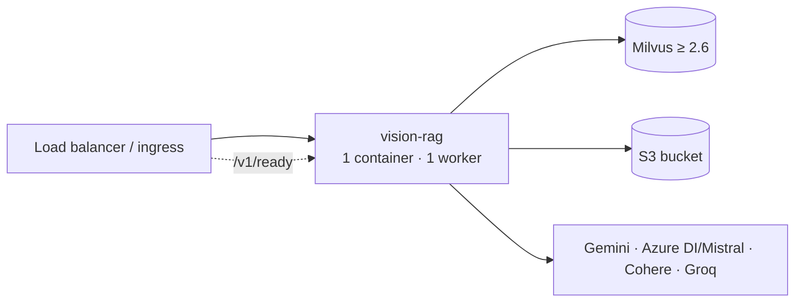

# Deployment

## Topology



The service is **one process, one uvicorn worker**. The ingestion admission gate is in-process, so scaling
is horizontal: run more containers, each accepting one document at a time. Queries are not gated and are
cheap to run alongside an ingestion.

## Container

```bash
docker build -t vision-rag .
docker run --env-file .env -p 8000:8000 vision-rag
```

The image (`python:3.12-slim`) installs `requirements.txt`, copies `app/`, sets `ARTIFACT_MODE=production`,
and runs `uvicorn app.main:app --workers 1`. Its `HEALTHCHECK` hits `/v1/health`.

**Mount a persistent volume at `INGEST_WORKSPACE_DIR`** (compose: `./ingest_workspace:/srv/ingest_workspace`).
It holds the job records (`_jobs/`), staged uploads (`_uploads/`) and the per-document workspaces. Without it a
container restart loses running jobs and their progress. With it the restarted service continues the interrupted
job by itself — see [INGESTION_RELIABILITY.md](INGESTION_RELIABILITY.md). Run one container per volume: the
single-flight gate and the job records assume one process owns the directory.

## Required environment

| | |
|---|---|
| **Always** | `GOOGLE_API_KEY`, `COHERE_API_KEY`, `MILVUS_HOST`, `MILVUS_PORT`, plus the selected OCR engine's keys — `AZURE_OCR_ENDPOINT`/`AZURE_OCR_KEY` (default) or `MISTRAL_API_KEY` |
| **Optional** | `GROQ_API_KEY` (reformulation), `S3_UPLOAD_ENABLED` + `S3_BUCKET`/`AWS_DEFAULT_REGION` + `AWS_ACCESS_KEY_ID`/`AWS_SECRET_ACCESS_KEY` (or an IAM role), `MILVUS_TOKEN` / `MILVUS_USER`+`MILVUS_PASSWORD`, `MILVUS_SECURE=true` |
| **Tracing** | `LANGFUSE_ENABLED=true` + `LANGFUSE_PUBLIC_KEY`/`LANGFUSE_SECRET_KEY` (+ `LANGFUSE_HOST` for self-hosted), optionally `PIPELINE_VERSION` — [OBSERVABILITY.md](OBSERVABILITY.md). Enabled without keys fails at startup |
| **Production** | `APP_ENV=production` (JSON logs), `ARTIFACT_MODE=production` (no local artifacts) |

See [CONFIGURATION.md](CONFIGURATION.md) for every knob.

## Milvus

- Server **2.6 or newer** (compose: `v2.6.24` with `DEPLOY_MODE: STANDALONE`): Japanese collections use the
  Lindera analyzer, which the 2.5.x images do not ship. On 2.5.x English still works and Japanese ingestion
  fails with a clear error. 2.6 runs on its own volume (`milvus-data-v26`); the 2.5 volume is kept
  for rollback — see [JAPANESE_RETRIEVAL.md](JAPANESE_RETRIEVAL.md#3-operations).
- Milvus downloads the Lindera IPADIC dictionary (~45 MB) into its volume on first use: give the container
  outbound network access once, or pre-seed `/var/lib/milvus/analyzer/lindera`.
- Collections are created on first upload with the dense index from `milvus_index_type` /
  `milvus_metric_type` (`FLAT` / `COSINE` by default). For large collections set
  `MILVUS_INDEX_TYPE=HNSW` (or pass `milvus_index_params`) **before** the first ingestion — index type is
  fixed at creation.
- A collection created with a different metric still works: the retriever reads the live index metric at
  startup and logs a WARNING if it differs from config.

## Readiness & probes

| Probe | Endpoint | Semantics |
|---|---|---|
| liveness | `GET /v1/health` | process is up |
| readiness | `GET /v1/ready` | 200 when Milvus answers `list_collections` within 3 s; 503 otherwise. `accepting_documents=false` while an ingestion runs (queries still served) |

## S3 permissions

The role/credentials used by boto3 need, on the artifact bucket:

| Prefix | Operations | Why |
|---|---|---|
| `{document_id}/*` | `s3:GetObject`, `s3:PutObject`, `s3:DeleteObject` | artifact versions, `current.json`, retention |
| `_collections/*` | `s3:GetObject`, `s3:PutObject`, `s3:DeleteObject` | the collection registry (query reformulation; deleted with the collection) |
| `_datasets/*` | `s3:GetObject`, `s3:PutObject` | ground-truth dataset versions ([DATASETS.md](DATASETS.md)); recommended explicit **Deny** of `s3:DeleteObject` on `_datasets/*/versions/*` so historical versions are immutable at the bucket level too |
| bucket | `s3:ListBucket` | retention and dataset version listing |

The evaluation pipeline needs only `s3:GetObject` on `_datasets/*` and `s3:ListBucket` with `s3:prefix` =
`_datasets/*`. Every client uses botocore's standard retry mode with `S3_CONNECT_TIMEOUT_SECONDS` /
`S3_READ_TIMEOUT_SECONDS`, so an S3 outage surfaces as an error (502 on dataset routes) instead of a hung request.

## Sizing

- **Memory**: uploads are streamed to disk, never held whole in memory; the largest in-memory objects are the
  chunk store and merged chunks of one document (tens of MB for 1,000 pages). 1–2 GiB per container is comfortable.
- **Disk**: per document in flight, roughly 2× the PDF (the PDF plus OCR window sub-PDFs, removed after stitching)
  plus ~0.5 GB of 200-DPI page images for 1,000 pages, plus JSON artifacts. Production removes it on success.
- **CPU**: page rendering (≈ 2 min for 1,000 pages, overlapped with OCR) and hashing are the only CPU-bound steps;
  everything else waits on providers.
- **Time**: ingestion is dominated by one Gemini call per page (plus retries): ≈ 2–2.5 h for 1,000 pages with the
  defaults. Use `POST /v1/ingestion-jobs` for anything long; `POST /v1/documents` keeps the request open until
  the pipeline finishes.
- **Retrieval latency**: one Cohere embed + two parallel Milvus searches + one Cohere rerank; typically
  well under a second.

## Logs

JSON per line in production, e.g.

```json
{"timestamp":"2026-09-11T10:00:00Z","level":"INFO","service":"vision-rag","environment":"production",
 "log_module":"API","request_id":"…","document_id":"manual","message":"document processing completed",
 "channel":"pdf","stage":"completed","status":"completed","duration_ms":184233,"page_count":132,"chunk_count":418}
```

Useful filters: `stage=completed status=completed` (throughput), `level=ERROR` (failed arms / stages),
`log_module=RETRIEVER` (per-query one-line summaries with hit counts and latency). `request_id` equals the
`X-Request-Id` response header, also inside ingestion-job threads; query text is logged at INFO only as a
sha256 fingerprint (the text itself at DEBUG). Per-stage timing, model usage and errors are in Langfuse when
tracing is on ([OBSERVABILITY.md](OBSERVABILITY.md)).

## Upgrade notes

- The collection schema is declared explicitly with `pymilvus` (`app/retrieval/milvus_schema.py`);
  `langchain-milvus` is no longer used. Before moving the `pymilvus` pin, run `pytest` and the live tests
  (`MILVUS_INTEGRATION_URI=… pytest tests/test_vector_db_milvus.py`) against a scratch Milvus.
- Collections created before language profiles (no manifest) remain searchable as English and are
  read-only; re-ingest them into new collections to use the new layout.
- Re-ingesting a document **replaces** its chunks: they are upserted by `chunk_id`, then the document's rows that
  no longer exist in the new version are deleted. Other documents in the collection are untouched.
- Chunk ids are now assigned from page and order (`page_{N}_chunk_{M}`) instead of trusted from the model. The
  first re-ingestion of a document indexed before this change may therefore replace rows under new ids; the old
  ones are removed as stale.
- Debug-mode workspaces moved from `DEBUG_WORKSPACE/<document_id>.pdf` + `DEBUG_WORKSPACE/<document_id>/` to
  `DEBUG_WORKSPACE/<document_id>/` (PDF, marker, artifact folder), the same layout as production.
- `groundtruth_dataset.csv` gained two leading columns, `case_id` and `document_id` (the `retrieval_v1` dataset
  format); spreadsheet consumers of the old six-column file see them first. Job records gained `request_id`,
  `trace_ids` and `request.execution`; records written by older versions load unchanged.
- Dataset versions need S3 conditional writes (`PutObject` with `If-None-Match`): boto3 ≥ 1.35 and an S3 (or
  S3-compatible) endpoint that supports them.
