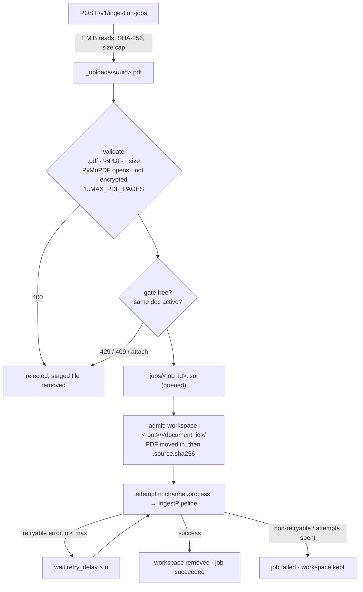

# Ingestion reliability (large documents)

How a 1,000-page PDF gets from upload to a complete, searchable collection without losing work, paying
twice, or reporting a partial document as done. Read this before changing anything in `app/orchestration/`,
`app/ingestion/` or the artifact writers.

## Guarantees

1. **Complete or failed, never partial.** A job succeeds only when every page was chunked, every chunk was
   merged and indexed, and (when enabled) published. A missing page is an error with page numbers. It is never
   silently dropped.
2. **No truncated artifacts.** Every file a later run may reuse is written to a temp file and renamed
   (`app/utils/fs.py`). A crash leaves the previous file or the new one, never half of one.
3. **Work is paid for once.** OCR windows, chunked pages (including pages that produced no chunks),
   classifications and grounded pages are reused by any later run of the same PDF.
4. **Runs survive restarts.** Job records and workspaces live on disk. A restart continues the
   interrupted job by itself.
5. **The index matches the document.** Re-ingesting a document upserts its chunks, then deletes its rows
   from the earlier version that are gone. Other documents in the collection are untouched.

## The path of an upload

The workspace root is `INGEST_WORKSPACE_DIR` (or `DEBUG_WORKSPACE` in debug mode). It holds one folder per
document plus `_jobs/` (job records) and `_uploads/` (staging, cleared at startup).

## Resume points

| Stage | What is reused on the next run | Where |
|---|---|---|
| 1 OCR | finished windows (`ocr_windows/pXXXXX-YYYYY/window.md`), then the stitched `<doc>.md` once it exists (the window folder is removed after stitching) | `app/ingestion/ocr/windows.py` |
| 2 render | every page image newer than the PDF | `app/utils/pdf_utils.py` |
| 3 chunk | every page in `target_chunks.json`, plus pages listed in `target_chunks.empty_pages.json` — only while `target_chunks.json` is newer than the PDF (else both are discarded and every page is chunked again) | `app/ingestion/pipeline.py`, `app/chunking/store.py` |
| 4 merge, 6 vocab | always recomputed (pure, cheap) | |
| 5 classify | every assignment whose chunk content fingerprint is unchanged | `app/classification/memory.py` |
| 7 ground | every page without an `error` entry | `app/groundtruth/autogrounding.py` |
| 8 index | not cached. Re-embedding is cheap next to stages 1–3, and the upsert is idempotent by primary key | `app/retrieval/vector_db.py` |

Freshness is mtime-based for stages 1–3 (artifact newer than the PDF). That is why the PDF is moved into the
workspace only once: replacing it would make every artifact look stale.

## Error classification

| Error | Where decided | Effect |
|---|---|---|
| Transient (5xx, 408, 429, timeouts, connection resets) | per call | retried with exponential back-off (`ocr_max_retries`, `chunking_max_retries`, …) |
| Deterministic 4xx on one page (e.g. an invalid image) | `chunker._is_retryable` | that page fails at once; the other pages continue |
| Fatal for every page (401/403/404, invalid API key) | `is_fatal_gemini_error` | stage 3 stops at once and cancels pages not yet started |
| OCR misconfiguration / empty result | `OCRConfigurationError`, `OCRResultError` | not retried |
| A page that failed every retry | `IncompleteStageError` | raised after all other pages are stored; a rerun chunks only those pages |
| Invalid request (`ChannelError`), collection language mismatch (`RetrievalError`) | job manager | job fails, `retryable: false`, no automatic retry |
| Anything else in a run | job manager | job retried up to `INGEST_JOB_MAX_ATTEMPTS` runs, then fails with `retryable: true` |

## Restarts

On startup the service:

1. removes `_uploads/` (requests a restart cut off);
2. loads `_jobs/*.json`;
3. continues the newest job still marked `queued`/`running` from its workspace, if
   `INGEST_JOB_AUTO_RESUME=true`, its workspace still holds the PDF, and attempts remain. The interrupted
   run counts as one attempt, so a document that crashes the process every time stops after
   `INGEST_JOB_MAX_ATTEMPTS`;
4. marks every other interrupted job `failed` / `INTERRUPTED` / `retryable: true`. Resubmitting the PDF
   resumes it.

`GET /v1/ingestion-jobs/{id}` keeps working across restarts for `INGEST_JOB_RETENTION_HOURS` after a job finishes.
Durability needs `INGEST_WORKSPACE_DIR` on a persistent volume (compose mounts `./ingest_workspace`).

## Operating a 1,000-page ingestion

- Use `POST /v1/ingestion-jobs` and poll. `POST /v1/documents` holds the HTTP connection for the whole run.
- Expect about 2–2.5 h with the defaults (see [CONFIGURATION.md](CONFIGURATION.md#throughput-large-documents)).
  Stage 3 dominates. Raise `CHUNKING_CONCURRENCY` only as far as the Gemini quota allows: 429s are retried, but
  a page that exhausts its retries costs a rerun of that page.
- Disk per document is roughly the PDF + the PDF again (OCR windows, removed after stitching) + about 0.5 GB of
  page images at 200 DPI + JSON artifacts. Production removes it all on success.
- `MAX_PDF_PAGES` (2,000) and `MAX_UPLOAD_SIZE_BYTES` (200 MiB) bound one job. Both are checked before any paid
  call.
- A job that ends `failed` with `retryable: true` after its automatic attempts is safe to resubmit as is. Its
  `error.message` names the stage and, for stage 3, the page numbers.

## Review findings fixed (2026-10)

| # | Problem | Fix |
|---|---|---|
| 1 | OCR markdown, `pages.json`, `merged_chunks.json`, `classification_memory.json`, `token_usage.json`, `vocab_index.json`, the CSV and the workspace PDF were written in place. A crash mid-write left a newer, non-empty, truncated file that the next run reused as finished (silently missing pages). | `app/utils/fs.py` atomic writes everywhere; the PDF is moved in atomically and the hash marker is written after it |
| 2 | Pages the OCR engine skipped were never chunked, and the run still succeeded. | `pages.json` is reconciled with the PDF's page count; missing pages get empty text and are chunked from their image (warning logged) |
| 3 | Model-written `chunk_id`s could repeat. Fused ids `page_{a}_{b}_chunk` could too. Either failed stage 8 after hours of work (duplicate primary keys). | ids are assigned as `page_{N}_chunk_{M}` from page and order; repeated fused ids get `_2`, `_3`, … |
| 4 | Re-ingesting a shorter version left the old version's extra rows searchable. | `replace_document` deletes the document's rows that are no longer among its chunks, after the upsert |
| 5 | Pages that produced zero chunks were re-chunked (and paid for) on every resume. | `target_chunks.empty_pages.json` |
| 6 | One page failing all retries cancelled the remaining pages. | every page is attempted; failures are reported together (`IncompleteStageError`); fatal errors still stop at once |
| 7 | OCR calls had no retry or timeout, and PDFs uploaded to Mistral were never deleted. | `with_retries`, `ocr_request_timeout`, best-effort `files.delete` |
| 8 | Jobs lived in memory: a restart lost them and needed a manual resubmit; a transient failure needed one too. | job records on disk, automatic attempts, startup recovery |
| 9 | Uploads were read into memory and held by the job for hours; the size cap applied only after the whole body was read. | streamed to disk with the cap enforced while streaming; the PDF is opened and checked before any paid call |
| 10 | The job was marked finished before the gate was released, so an immediate next submit got 429. | the gate is released first |
| 11 | Stage 8 embedded everything in one call sequence with no progress. | batches of `index_batch_size` with progress |
| 12 | Smaller: auto-grounding error pages were never retried; worker-thread logs lost `document_id`; the OCR window progress counter could race; an unknown page count broke an OCR log line; in debug mode a different PDF under the same name was ignored; OCR window PDFs were uploaded to S3. | fixed in place |
